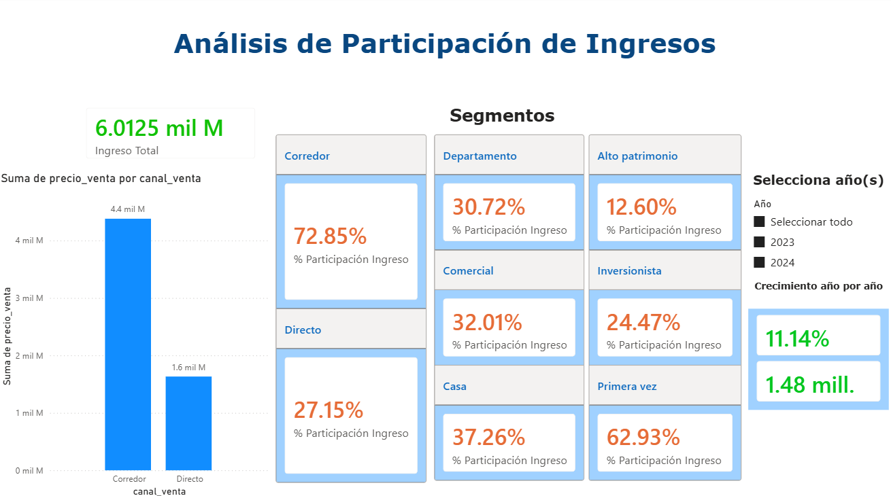
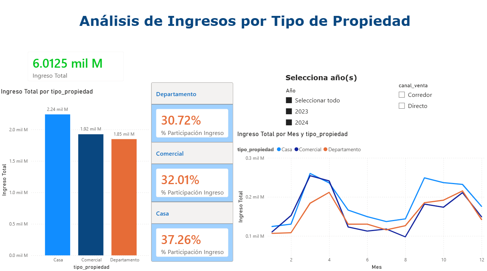
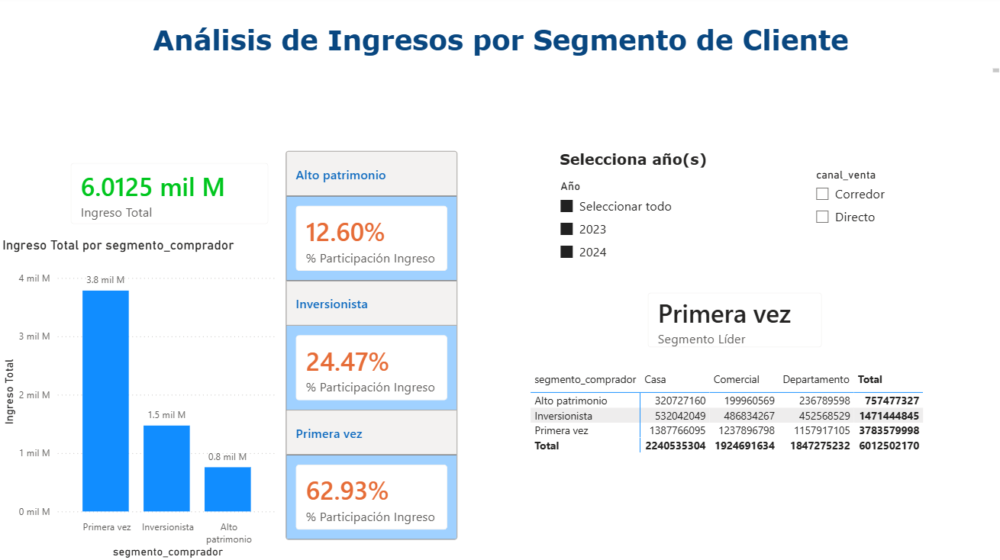
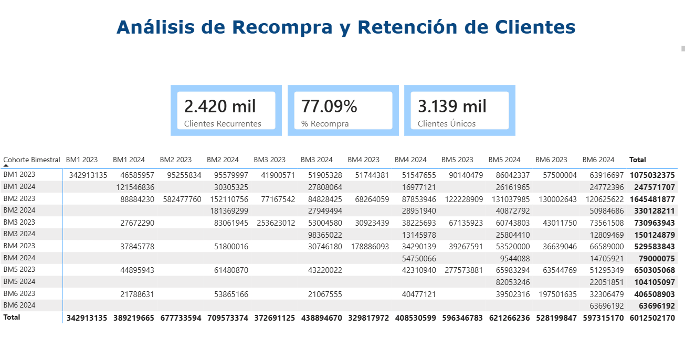
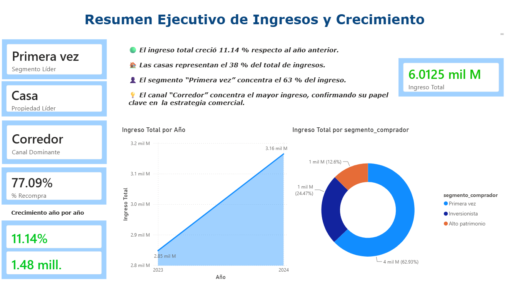

# Estrategia-comercial-de-Andes-Capital-Real-Estate
dashboard interactivo en Power BI que permite analizar ventas, clientes y propiedades para apoyar decisiones estratégicas.

¿Cuál es el ingreso total generado por la empresa?
¿Cuántas propiedades se han vendido?
¿Cuál es el precio promedio de venta?
¿Cuál es la comisión total generada por la empresa?
Análisis comercial

¿Qué tipo de propiedad genera más ingresos?
¿Qué segmento de clientes compra más propiedades?
¿Qué canal de venta genera mayor ingresos?
Análisis temporal

¿Cómo evolucionan las ventas en el tiempo?
¿El negocio está creciendo año contra año?
¿Cómo va el desempeño acumulado del año actual (YTD)?
Cohortes de clientes

¿Los clientes vuelven a comprar después de su primera compra?
¿Qué cohortes de clientes generan más compras/ingresos con el tiempo?

🧹 Limpieza de datos

Antes del modelado, debes validar y depurar la información.

Tipos de datos
fecha_venta debe estar en formato Date.
Los campos numéricos deben estar correctamente formateados.
porcentaje_comision debe estar en formato porcentaje.
Valores nulos
Revisar valores nulos en las tablas.
Justificar si deben eliminarse o mantenerse.
Duplicados
Validar que no existan duplicados en las claves primarias de:
dim_clientes
dim_propiedades

🧩 Modelado de datos

Modelo requerido: Esquema estrella
El modelo debe estructurarse en formato estrella:

hecho_ventas_propiedades como tabla central.
Tablas dimensionales conectadas:
dim_clientes
dim_propiedades
dim_fecha (creada por ti, en caso de que aplique)
Requisitos de las relaciones:

Cardinalidad uno a muchos (1:*)
Dirección de filtro simple (single)
Relaciones basadas en las claves correctas
Todas las relaciones deben estar activas

📊 Creación de medidas

 Medidas base
 
Crear como mínimo las siguientes medidas:

Ingreso Total (suma del precio_venta)
Cantidad de Ventas
Ticket Promedio
Comisión Total
Estas métricas permitirán analizar el desempeño general del negocio.

Medidas con contexto de filtro

Participación de ingresos por tipo de propiedad
Participación de ingresos por canal de venta
Participación de ingresos por segmento de cliente
Para ello:

Inteligencia de tiempo

Ventas Year to Date (YTD)
Ventas Month to Date (MTD)
Ventas del año anterior
Crecimiento Year over Year (YoY)
Estas métricas permitirán analizar la evolución del negocio en el tiempo.

Medidas para análisis de cohortes

Primera compra por cliente → fecha mínima de compra de cada cliente.
Mes Cohorte → mes en que el cliente realizó su primera compra (mes de adquisición).
Mes Venta → mes en que ocurre cada transacción. Este campo permite identificar cuándo el cliente vuelve a comprar después de su primera compra.
Estos cálculos permitirán construir una matriz de cohortes donde:

Filas representen el mes de cohorte
Columnas representen el mes de venta
Valores muestren cantidad de ventas o ingresos

KPIs principales

Ingreso Total
Cantidad de Ventas
Ticket Promedio
Comisión Total
Tendencia de ventas en el tiempo
Ingresos o ventas por ciudad
Crecimiento Year over Year (YoY)

Análisis Comercial

Ingreso por tipo de propiedad
Ventas o ingresos por canal de venta
Ventas o ingresos por segmento de cliente
Tabla con formato condicional (colores semáforo)
Sugerencia de campos:
tipo_propiedad
Ingreso Total
Cantidad Ventas
Ticket Promedio

Análisis de Cohortes

Matriz de cohortes
Filas → Mes Cohorte
Columnas → Mes Venta
Valores → Cantidad Ventas o Ingreso Total
Esto permitirá observar si los clientes vuelven a comprar y comparar cohortes en el tiempo.

# Resumen Ejecutivo

Hallazgos clave

El ingreso total del periodo fue de 6.0125 mil M, con un crecimiento del 11.14 % respecto al año anterior.
El canal “Corredor” concentró el 72.85 % del total de ingresos, confirmando su papel dominante en la estrategia comercial.
El tipo de propiedad “Casa” generó el mayor revenue, representando el 37 % del total.
El segmento “Primera vez” concentró el 63 % del ingreso total, posicionándose como el grupo líder de clientes.
La tasa de recompra alcanzó el 77.09 %, reflejando una alta retención y fidelización de clientes.
Métricas principales

Ingreso Total 6.012:5 mil M
Crecimiento YoY: 11.14 %
Clientes Únicos: 3.139 mil
Clientes Recurrentes: 2.420 mil
% Recompra: 77.09 %
Insights accionables

El segmento “Primera vez” concentra la mayor parte del ingreso y muestra una alta recurrencia en cohortes recientes.
Las propiedades tipo “Casa” mantienen un desempeño estable y son el principal motor de crecimiento.
El canal “Corredor” es el más eficiente en generación de ingresos y debe seguir siendo el eje de la estrategia comercial.
Las cohortes bimestrales de 2023 presentan una mejor retención que las de 2024, lo que sugiere oportunidad de mejora en la captación reciente.
Recomendaciones estratégicas

Priorizar la comercialización de propiedades tipo Casa, que lideran el revenue total.
Fortalecer el canal Corredor, optimizando incentivos y soporte para mantener su liderazgo.
Implementar estrategias de retención enfocadas en clientes del segmento Primera vez, para consolidar su recompra.
Monitorear las cohortes más recientes y ajustar campañas de seguimiento para mejorar la recurrencia en 2024.

